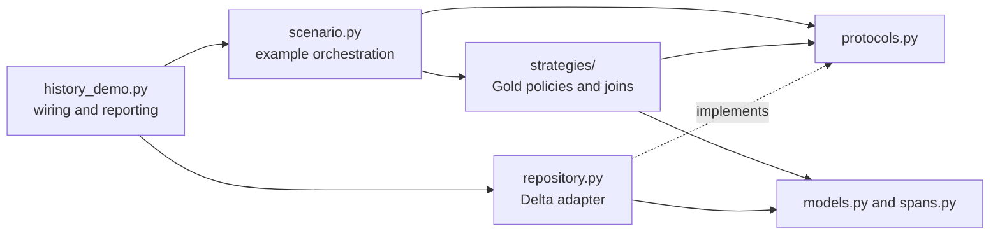

# SCD Type 2: Silver to Gold

**Three ways to reuse Silver history in Gold, with an executable local Delta Lake example.**

Companion code for **Silver Already Keeps History. Why Is Gold Building It Again?** The project demonstrates how copying an existing history table and replaying its changes can duplicate history, then compares three designs for avoiding that mistake.

Silver represents the curated source layer; Gold represents its downstream analytical model. A **slowly changing dimension, Type 2 (SCD Type 2)** preserves historical values as validity periods. A **change data feed (CDF)** records the row changes used to maintain a downstream copy.

The example uses synthetic customer and adviser data, Python, pandas, and the open-source `deltalake` library (delta-rs). It runs locally without Spark or a Databricks workspace.

## Choose a design

| Design | Appropriate when | Local implementation |
| --- | --- | --- |
| **1. Carry Silver's history** | Gold needs the same customer spans and validity dates. | [`CarrySilverView`](src/strategies/option_1_carry_view.py) reads Silver on demand, with optional column renaming. |
| **2. Copy at a cut point** | Gold needs a separate copy at the same grain. | [`CutPointCopy`](src/strategies/option_2_cut_point.py) takes a snapshot at version `V`, then applies changes from `V + 1` by span key. |
| **3. Build history at a new grain** | Gold combines histories, such as customer city and adviser assignment. | [`temporal_join`](src/strategies/option_3_own_history.py) intersects their validity periods. |

**Implementation scope:** Silver is a real Delta table on local disk. Option 1 is a Python read-through wrapper; Option 2 keeps Gold and its checkpoint in memory; Option 3 returns joined value objects. The demo does not create a SQL view, persist a Gold table, or execute Databricks AUTO CDC or a pipeline full refresh.

## Quick start

Requirements: **Python 3.10+**, `pip`, and Bash for the helper script. The first setup requires access to the Python package index. `make` is optional.

Run from the repository root:

```bash
./run_demo.sh
```

The script creates `.venv` if needed, installs `requirements.txt`, runs the tests, and prints the scenario results. `deltalake` is pinned to `1.6.6`; the other dependencies have minimum versions.

The demo deletes and recreates the repository's `lake/` directory on each run. Keep that directory reserved for generated demo data. The Python helper `run(lake)` likewise removes the directory passed to it.

To run the same steps manually:

```bash
python3 -m venv .venv
.venv/bin/python -m pip install -r requirements.txt
.venv/bin/python -m pytest
.venv/bin/python -m src.history_demo
```

### Development commands

| Command | Action |
| --- | --- |
| `make` | Run lint, formatting checks, type checks, tests, and the demo. |
| `make setup` | Create `.venv` and install runtime and development tools. |
| `make test` | Run `pytest`. |
| `make lint` | Run `ruff check` and `ruff format --check`. |
| `make types` | Run `mypy src`. |
| `make demo` | Print the demo results. |
| `make clean` | Remove `.venv`, `lake/`, tool caches, and Python bytecode caches. |

The check and demo targets run dependency setup first. Once dependencies are installed, invoke tools directly with `.venv/bin/python -m pytest`, `.venv/bin/python -m ruff check .`, `.venv/bin/python -m ruff format --check .`, or `.venv/bin/python -m mypy src`.

## What the example demonstrates

Customer **42** starts in Pune and moves to Mumbai on **1 June 2026**. A later correction changes the move date to **20 May 2026**. Separately, the customer's adviser changes from Santosh to Ravi on **15 March 2026**. Customer **7** supplies another change after the initial Gold snapshot.

| Step | Expected result |
| --- | --- |
| Record customer 42's move | CDF contains `update_preimage`, `update_postimage`, and `insert`. Silver has **2 spans**, **0 overlapping pairs**, and **1 open span** for that customer. |
| Copy current Silver and append all retained new values | Gold grows to **5 spans**, **6 overlapping pairs**, and **3 open spans** for customer 42. This is the intentional failure case. |
| Bootstrap Option 2 at version `V = 2`, then catch up after `V` | Applying later changes with `MirrorBySpanKey` keeps Gold equal to Silver. |
| Correct the move date, ignoring deletes | Gold retains **3 spans**, **1 overlapping pair**, and **2 open spans** for customer 42. |
| Apply the correction's deletes and inserts | Gold matches Silver again: **2 spans**, **0 overlapping pairs**, and **1 open span**. |
| Read Option 1 after the changes | The wrapper returns Silver's current history. |
| Join city and adviser histories in Option 3 | The Pune span splits at the adviser change. Joining every historical city to the current adviser incorrectly assigns Ravi to January. |

Option 3 deliberately uses the customer snapshot **before the move-date correction**, so its output still changes city on 1 June:

```text
Pune    Santosh  [2026-01-10, 2026-03-15)
Pune    Ravi     [2026-03-15, 2026-06-01)
Mumbai  Ravi     [2026-06-01, open)
```

The executable prints all outcomes. [`test_article_claims.py`](tests/test_article_claims.py) checks the reported values against a real temporary Delta table.

## Example output

The following successful `./run_demo.sh` run passed all **19 tests** and printed the results below. Test timing varies by machine; package installation and update notices are omitted.

```text
$ ./run_demo.sh
...................                                                      [100%]
19 passed in 0.53s
deltalake 1.6.6 on local disk; not a Databricks runtime
1. One move wrote these change rows: ['update_preimage', 'update_postimage', 'insert']. Silver for customer 42: {'spans': 2, 'overlapping_pairs': 0, 'open_spans': 1}
2. Copy Silver and replay retained changes as rows: customer 42 {'spans': 5, 'overlapping_pairs': 6, 'open_spans': 3}
3. Option 2, one cut point (V=2), then later changes by key: Gold matches Silver: True
4. Correction change types: ['delete', 'insert']
   Ignore deletes: customer 42 {'spans': 3, 'overlapping_pairs': 1, 'open_spans': 2}
   Apply deletes:  customer 42 {'spans': 2, 'overlapping_pairs': 0, 'open_spans': 1}; matches Silver: True
   Silver after the correction: [('Pune', '2026-01-10', '2026-05-20'), ('Mumbai', '2026-05-20', None)]
5. Option 1, a view over Silver after the move and the correction: customer 42 {'spans': 2, 'overlapping_pairs': 0, 'open_spans': 1}; matches Silver: True
6. Option 3, Gold changes the grain. Temporal join: [('Pune', 'Santosh', '2026-01-10', '2026-03-15'), ('Pune', 'Ravi', '2026-03-15', '2026-06-01'), ('Mumbai', 'Ravi', '2026-06-01', None)]
   Current-adviser join: [('Pune', 'Ravi', '2026-01-10', '2026-06-01'), ('Mumbai', 'Ravi', '2026-06-01', None)]
```

## Data and change semantics

Each customer span has four fields:

| Field | Meaning |
| --- | --- |
| `customer_id` | Integer customer identifier. |
| `city` | City valid during the span. |
| `valid_from` | Inclusive start date, as an ISO `YYYY-MM-DD` string. |
| `valid_to` | Exclusive end date in the same format; `null` means open-ended. |

The span key is **`(customer_id, valid_from)`**. Periods are half-open: `[valid_from, valid_to)`, so adjacent periods do not overlap. Dates describe business validity; Delta commit versions describe storage changes. The code compares date strings and assumes well-formed dates and intervals.

The Delta reader returns CDF rows in commit order, with deletes before inserts within a commit. [`MirrorBySpanKey`](src/strategies/change_appliers.py) ignores update preimages, upserts inserts and update postimages, and removes deleted keys. The correction rewrites the customer's two spans, producing deletes for the old rows and inserts for their replacements.

The two other appliers are deliberate counterexamples: `AppendChangedRows` duplicates updated spans, while `UpsertBySpanKey` leaves deleted spans behind. Sharing the `ChangeApplier` interface does not make these policies semantically equivalent.

See [`data/README.md`](data/README.md) for the seed fields and timeline.

## Architecture and SOLID assessment



The code broadly follows SOLID at the scale of a teaching project, with specific gaps:

| Principle | Assessment |
| --- | --- |
| **Single responsibility** | Persistence, span utilities, change policies, orchestration, and reporting are separated into focused modules. |
| **Open/closed** | `CutPointCopy` accepts an injected `ChangeApplier`; another policy can be added without changing its copy/catch-up logic. |
| **Liskov substitution** | Protocols and an in-memory reader fake support substitution. Schemas, change ordering, and version semantics need explicit contracts and shared adapter tests for stronger guarantees. |
| **Interface segregation** | Reads and writes are separate. However, `CarrySilverView` only needs `read()` and currently depends on a reader that also requires version and CDF methods. |
| **Dependency inversion** | Storage-consuming strategies use protocols; the executable wires in Delta. pandas remains the shared data representation, and the scenario selects the concrete demonstration policies. |

The current structure is useful; it does not require adding an inheritance hierarchy to every module. Before broadening the example, narrow the view's reader interface and document the snapshot, CDF ordering, and schema contracts expected of replacement adapters.

## Repository layout

```text
.
├── data/
│   ├── history.json                 # Synthetic customers, moves, correction, and advisers
│   └── README.md                    # Seed schema and timeline
├── src/
│   ├── models.py                    # Span keys, constants, and value objects
│   ├── protocols.py                 # Reader, writer, and change-applier interfaces
│   ├── repository.py                # Local Delta persistence and ordered CDF reads
│   ├── spans.py                     # Normalization, equality, and overlap diagnostics
│   ├── scenario.py                  # Example orchestration and structured results
│   ├── history_demo.py              # Composition root and printed report
│   └── strategies/
│       ├── change_appliers.py       # Append, upsert, and mirror policies
│       ├── option_1_carry_view.py    # Read-through wrapper over Silver
│       ├── option_2_cut_point.py     # Snapshot and incremental catch-up
│       └── option_3_own_history.py   # Temporal and current-adviser joins
├── tests/
│   ├── conftest.py                  # Temporary Delta scenario fixture and frame helper
│   ├── test_article_claims.py       # End-to-end checks of the example results
│   ├── test_spans.py                # Interval and history helper tests
│   └── test_strategies.py           # Policy tests with an in-memory reader
├── Makefile
├── pyproject.toml
├── requirements.txt
└── run_demo.sh
```

## Scope and limitations

- **Local demonstration:** all reads and change batches are materialized in pandas. Two synthetic customers illustrate correctness, not throughput or cost.
- **Demo-specific writes:** a move closes the old span and appends the new one in two separate commits. A reader can observe the intermediate state. Date correction reconstructs exactly two spans from the customer's first span; it is unsuitable for arbitrary multi-move histories.
- **No durable Gold lifecycle:** the Gold copy and returned version are not persisted atomically. Scheduling, crash recovery, retries, concurrency, and CDF retention recovery are outside the implementation.
- **Input assumptions:** unique span keys, valid ISO dates, suitable source intervals, and ordered changes are assumed rather than validated. A key change must remove the old key; ignoring an update preimage alone cannot do that.
- **Join scope:** Option 3 drops periods without adviser coverage and does not resolve overlapping adviser assignments. Its result omits `customer_id`, matching the example's single-customer use; retain that identifier before generalizing it.
- **Engine scope:** the tested change shapes come from the local writes in this project. They do not establish how a Databricks pipeline or another engine will emit changes.

## Data and license

All example data is synthetic. No `LICENSE` file is included, and the repository does not currently declare a reuse license.

## Support

[](https://buymeacoffee.com/santoshshin)
